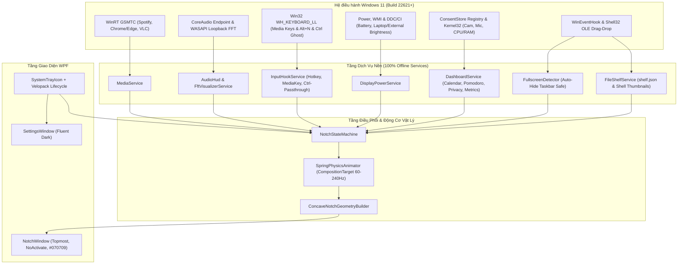
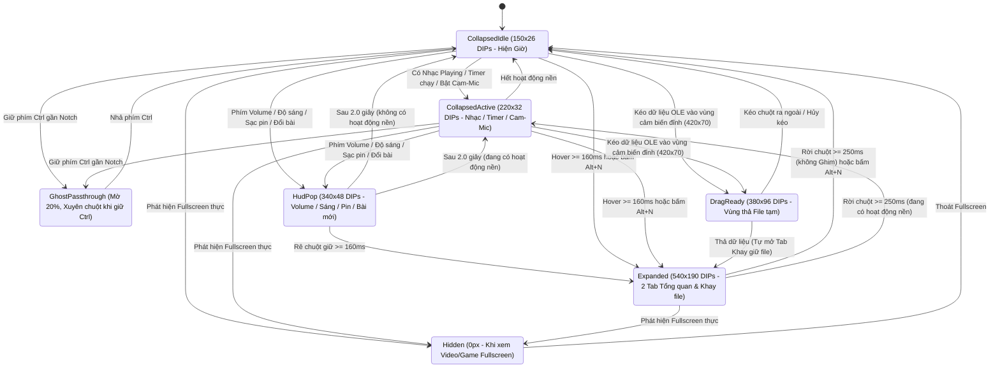

# Đặc Tả Kỹ Thuật & Sản Phẩm Chính Thức: `WinNotch`

- **Phiên bản tài liệu:** `1.0.0-final` *(Đã chốt toàn bộ quyết định thiết kế)*
- **Tên định danh ứng dụng:** `WinNotch` (`WinNotch.exe`, Namespace `WinNotch`, dữ liệu `%LocalAppData%\WinNotch\`)
- **Nền tảng mục tiêu:** Windows 10 (19041+) & Windows 11 (đã hiệu chuẩn trên **Windows 11 Build 22621, 1920×1080 @ 125% DPI = 1536×864 DIPs**)
- **Công nghệ cốt lõi:** C# 13 / .NET 9 (`net9.0-windows10.0.22621.0`) + WPF + Win32 / WinRT Native Interop
- **Nguyên tắc quyền riêng tư:** **100% Offline** — Không gọi mạng, không thu thập dữ liệu, không cần tài khoản.
- **Định dạng phân phối:** Bộ cài đặt 1 chạm **`WinNotch-Setup.exe` (Velopack)** + Bản chạy ngay **`WinNotch-Portable-win-x64.zip`**.

---

## 1. Bảng Tổng Hợp Các Quyết Định Thiết Kế Đã Chốt (ADR)

| Hạng mục | Quyết định đã chốt | Giải pháp kỹ thuật tương ứng |
| :--- | :--- | :--- |
| **1. Danh tính & Cấu trúc** | Tên chính thức **`WinNotch`** | Lưu cấu hình & khay file tại `%LocalAppData%\WinNotch\`; người dùng chủ động khởi tạo thư mục repo. |
| **2. Chất liệu & Màu sắc** | **Đen tuyền hòa viền màn hình (`#070709`)** | Vỏ Notch màu đen đặc `#070709` tiệp với viền bezel vật lý; thẻ nội dung bên trong phủ kính mờ `#12FFFFFF` + viền mảnh `#1AFFFFFF`. |
| **3. Trạng thái Thu gọn** | **Smart Adaptive (Thích ứng ngữ cảnh)** | Khi rảnh: `150 × 26 DIPs` (hiện giờ `HH:mm` mảnh). Khi có Nhạc / Timer / Cam-Mic: tự nới sang `220 × 32 DIPs`. |
| **4. Chống cấn Tab trình duyệt** | **Hover `160ms` + `Alt + N` + Giữ `Ctrl` bấm xuyên** | Giữ chuột `160ms` mới bung; giữ phím `Ctrl` kích hoạt **Ghost Mode** (mờ `20%` + bật `WS_EX_TRANSPARENT`) cho phép nhấp xuyên xuống Tab trình duyệt bên dưới. |
| **5. Bố cục Mở rộng** | **2 Tab thông minh (`540 × 190 DIPs`)** | Tab **`Tổng quan`** (2 cột: Nhạc/Quick Sliders + Lịch/Pomodoro/CPU-RAM) và Tab **`Khay giữ file`** (tự chuyển tab khi thả file). |
| **6. Trạng thái không có Nhạc** | **Thẻ Thanh trượt Âm lượng/Độ sáng & Loa** | Khi chưa có phiên Media, cột trái hiện thiết bị âm thanh hiện tại, slider Volume/Brightness và nút mở nhanh app nhạc; sóng FFT chỉ bật khi Media thực sự `Playing`. |
| **7. Vòng đời Khay giữ file** | **Giữ bền vững để kéo thả nhiều lần** | Kéo file ra không làm mất file trong khay (hỗ trợ gửi cùng 1 file qua Zalo rồi qua Email); lưu `shelf.json` qua các lần tắt máy + có tùy chọn *"Tự xóa sau khi kéo ra"* trong Settings. |
| **8. Xử lý Volume OSD Win11** | **Thay thế an toàn qua `WH_KEYBOARD_LL`** | Bắt phím Media `VK_VOLUME_*` ở user-mode và chỉnh trực tiếp `CoreAudio` (±2%) để thanh Volume đáy màn hình của Windows 11 không nhảy lên trùng lặp (có công tắc Bật/Tắt trong Settings). |
| **9. Bộ cài đặt ứng dụng** | **Velopack (`Setup.exe` 1 chạm) + Portable `.zip`** | Cài trong ~2 giây vào `%LocalAppData%\WinNotch` không đòi quyền Admin UAC, đăng ký chuẩn vào *Windows Settings > Installed Apps* & Start Menu. |

---

## 2. Kiến Trúc Tổng Thể Hệ Thống



---

## 3. Kỹ Thuật Cửa Sổ Overlay, Hình Học & Tương Tác Chuẩn Xác

### 3.1. Hình học Tai Thỏ Bo Lõm (`ConcaveNotchGeometry`)
- Notch nằm sát cạnh trên màn hình (`Top = 0`, căn giữa theo chiều ngang màn hình mục tiêu).
- Vẽ bằng một `StreamGeometry` duy nhất màu `#070709`:
  - **2 tai bo lõm (Concave Top Ears)** nối tiếp tuyến với cạnh `Y = 0` (`EarRadius = 9 DIPs` khi thu gọn, `14 DIPs` khi mở rộng).
  - **2 góc đáy bo lồi (Convex Bottom Corners)** (`BottomRadius = 13 DIPs` khi thu gọn, `22 DIPs` khi mở rộng).
- Cửa sổ host WPF có khung bao cố định `600 × 240 DIPs` nền trong suốt `#00000000` — mọi vùng ngoài hình vẽ `StreamGeometry` đều tự động cho chuột nhấp xuyên qua.

### 3.2. Các Cờ Win32 & Chế Độ "Ghost Pass-Through" Khi Giữ `Ctrl`
1. **Ẩn khỏi `Alt + Tab` & Task View:** Áp dụng `WS_EX_TOOLWINDOW` (`0x00000080`) và `ShowInTaskbar = false`.
2. **Không cướp Focus (`NoActivate`):** Áp dụng `WS_EX_NOACTIVATE` (`0x08000000`) — bấm Play/Next, chỉnh slider Volume hay bấm Pomodoro trên Notch sẽ **không làm mất focus** của cửa sổ code/trình duyệt/game bên dưới.
3. **Chế độ bấm xuyên Tab trình duyệt (`Ctrl` Ghost Mode):**
   - Khi người dùng giữ phím `Ctrl` và đưa chuột vào vùng Notch (hoặc bấm `Ctrl + Click` / `Ctrl + W` trên tab trình duyệt bị Notch che), `InputHookService` bật ngay cờ Win32 `WS_EX_TRANSPARENT` (`0x00000020`) và hạ `Opacity` của Notch xuống `0.20`.
   - Mọi thao tác chuột đi thẳng 100% xuống Tab trình duyệt bên dưới. Ngay khi nhả phím `Ctrl`, Notch khôi phục trạng thái bình thường.

### 3.3. Thuật Toán Nhận Diện Fullscreen (Tương Thích Auto-Hide Taskbar & 125% DPI)

> [!WARNING]
> Trên các máy Windows 11 bật **Tự động ẩn Taskbar (Auto-Hide Taskbar)**, `WorkingArea` bằng đúng `MonitorBounds` (`1536 × 864 DIPs` ở màn hình `1920×1080 @ 125% DPI`). Nếu chỉ so sánh kích thước cửa sổ `>= WorkingArea`, mọi cửa sổ phóng to (Maximized Chrome / VS Code) sẽ bị nhận nhầm là Fullscreen và làm mất Notch!

Để xử lý triệt để, `FullscreenDetector` chỉ ẩn Notch khi thỏa **một trong hai** điều kiện chuẩn sau trên cùng màn hình chứa Notch:
1. `SHQueryUserNotificationState` trả về `QUNS_RUNNING_D3D_FULL_SCREEN` hoặc `QUNS_PRESENTATION_MODE` (Game DirectX/Vulkan độc quyền hoặc trình chiếu PowerPoint).
2. Cửa sổ Foreground (khác `Progman` / `WorkerW` Desktop của Windows) có `GetClientRect` quy đổi ra tọa độ vật lý phủ kín toàn bộ `MonitorPhysicalBounds (0, 0, 1920, 1080)` **VÀ** không mang kiểu cửa sổ Maximized có thanh tiêu đề chuẩn (`!(style.HasFlag(WS_MAXIMIZE) && style.HasFlag(WS_CAPTION))`) — bắt chính xác 100% chế độ **F11 trình duyệt, YouTube Fullscreen, VLC và Game Borderless Windowed**, đồng thời không bao giờ ẩn nhầm khi Maximize cửa sổ thông thường.

### 3.4. Máy Trạng Thái & Kích Thước Chuẩn (Đơn vị: WPF DIPs)



### 3.5. Bộ Giải Vật Lý Lò Xo (`SpringPhysicsAnimator`)
Chạy trên `CompositionTarget.Rendering` với bước thời gian thực `dt` (giới hạn an toàn `dt <= 0.033s` để chống vọt lố khi máy lag):
- **Mở rộng (`Expand` / `HudPop` / `DragReady`):** `Stiffness = 380`, `Damping = 26`, `Mass = 1.0` (độ nảy đàn hồi nhẹ tự nhiên).
- **Thu gọn (`Collapse`):** `Stiffness = 440`, `Damping = 38`, `Mass = 1.0` (thu gọn sắc nét, không dội ngược qua `Y = 0`).

---

## 4. Đặc Tả Chi Tiết Các Phân Hệ Nghiệp Vụ

### 4.1. Phân hệ Media, Sóng Nhạc FFT & Thẻ Điều Khiển Nhanh (Cột Trái Tab `Tổng quan`)
1. **Khi có Phiên Media đang mở (`Spotify`, `Chrome/Edge YouTube`, `Apple Music`, `VLC`...):**
   - Kết nối qua WinRT `GlobalSystemMediaTransportControlsSessionManager`.
   - **Ở `CollapsedActive` (`220 × 32`):** Bên trái là ảnh bìa `20 × 20` bo góc `5px`; bên phải là **4 cột sóng nhạc FFT thời gian thực** (`NAudio WasapiLoopbackCapture`, lấy phổ tần số 60Hz–8kHz làm mượt hàm mũ). *Quy tắc chống nhiễu:* Chỉ kích hoạt bộ thu FFT khi `PlaybackStatus == Playing` (tiếng "ting" thông báo của Zalo/Windows khi không phát nhạc sẽ không làm nhảy sóng).
   - **Ở `Expanded` (Cột trái `255 × 140`):** Ảnh bìa `56 × 56` kèm vùng sáng mờ **Ambient Glow** lấy màu chủ đạo từ bìa đĩa, tên bài hát (cuộn ngang nếu dài), nghệ sĩ, thanh tua nhạc trực tiếp (Seekbar) và cụm nút `Prev`, `Play/Pause`, `Next`.
2. **Khi KHÔNG có Phiên Media nào hoạt động (Trạng thái rảnh thông minh):**
   - Cột trái tự động chuyển thành **Thẻ Âm Thanh & Màn Hình Nhanh (Quick Control Card)**:
     - Hiển thị tên thiết bị đầu ra âm thanh hiện tại (ví dụ: `🔊 Speakers (Realtek Audio)` hoặc `🎧 AirPods`).
     - **Thanh trượt Âm lượng nhanh** (kéo hoặc lăn chuột, có nút Mute nhanh).
     - **Thanh trượt Độ sáng nhanh** (kéo hoặc lăn chuột).
     - Nút nhỏ mở nhanh ứng dụng nghe nhạc gần nhất (nếu đã từng ghi nhận, ví dụ `Mở Spotify`).

### 4.2. Phân hệ HUD Hệ Thống & Thay Thế Thanh Volume Windows 11
- **Chế độ Thay thế Volume OSD gốc (`ReplaceSystemVolumeOsd = true` mặc định, có thể tắt trong Settings):**
  - `InputHookService` cài hook `WH_KEYBOARD_LL` (user-mode hợp chuẩn, không cần quyền Admin, không tiêm DLL vào `explorer.exe`).
  - Khi bắt được `VK_VOLUME_UP`, `VK_VOLUME_DOWN` hoặc `VK_VOLUME_MUTE`: trực tiếp gọi `IAudioEndpointVolume` cộng/trừ `2%` (hoặc đảo trạng thái Mute), kích hoạt `HudPop` trên `WinNotch` và trả về `1` để nuốt phím — nhờ vậy thanh Volume ở đáy màn hình Windows 11 không hiện lên trùng lặp.
  - *Fallback an toàn:* Khi cửa sổ đang active chạy dưới quyền Administrator (UIPI chặn hook mức thường), Windows vẫn xử lý phím như bình thường và `WinNotch` vẫn nhận callback `OnVolumeNotification` để cập nhật mức âm lượng.
- **Độ sáng màn hình (Brightness HUD):**
  - Laptop: lắng nghe `WmiMonitorBrightnessEvent` & điều khiển qua `WmiSetBrightness` (`root\wmi`).
  - Màn hình rời: điều khiển qua DDC/CI (`Dxva2.dll`).
- **Pin & Nguồn sạc (Battery HUD):**
  - Bắt `SystemEvents.PowerModeChanged` và kiểm tra `GetSystemPowerStatus`. Bung HUD kèm icon tia sét `#30D158` khi cắm sạc, báo rút sạc, và cảnh báo ở mốc `20%` (cam `#FF9F0A`) / `10%` (đỏ `#FF453A`).
- **Tương tác trực tiếp trên HUD:** Mọi thanh `HudPop` (`340 × 48 DIPs`, tự đóng sau `2.0s`) đều cho phép **lăn con lăn chuột** hoặc **kéo thanh trượt** ngay trên Notch. Nếu Notch đang mở sẵn `Expanded`, thông báo HUD hiển thị dạng dải pill gọn hoặc cập nhật trực tiếp slider mà không thu nhỏ khung đang mở.

### 4.3. Phân hệ Dashboard Nhanh 100% Offline (Cột Phải Tab `Tổng quan`)
- **Lịch tuần nội bộ:** Hiển thị Thứ, Ngày/Tháng tiếng Việt và dải 7 ngày trong tuần hiện tại (nổi bật ngày hôm nay, có mũi tên `<` `>` lật xem nhanh tuần trước/sau).
- **Đồng hồ bấm giờ / Pomodoro (`TimerService`):**
  - Nút bấm nhanh `5p`, `15p`, `25p`, `+1p` và `Tạm dừng / Đặt lại`.
  - Khi đang đếm ngược và thu gọn Notch về `CollapsedActive`, hiển thị pill đếm ngược `⏱ 24:59` cạnh sóng nhạc/giờ.
  - Khi hết giờ: phát âm báo nhẹ nội bộ (embedded `.wav`, không phụ thuộc mạng) và nhấp nháy viền hổ phách trên Notch cho tới khi bấm tắt hoặc sau 8 giây.
- **Chỉ báo Hệ thống & Quyền riêng tư (Privacy Dots):**
  - Thanh trạng thái siêu nhẹ ở chân cột phải: `CPU 12% • RAM 48% • 🔋 86%` (dùng Win32 `GetSystemTimes` & `GlobalMemoryStatusEx` chu kỳ 2 giây, tiêu tốn `< 0.05%` CPU).
  - **Chấm bảo mật Camera / Mic:** Theo dõi khóa Registry `HKCU\Software\Microsoft\Windows\CurrentVersion\CapabilityAccessManager\ConsentStore\webcam` và `microphone` (`LastUsedTimeStop == 0`). Hiện chấm xanh lá `#30D158` (Camera đang bật) và chấm cam `#FF9F0A` (Mic đang thu) ở cả chế độ Thu gọn lẫn Mở rộng (kèm tooltip tên ứng dụng đang dùng Cam/Mic).

### 4.4. Phân hệ Khay Giữ File Tạm (Tab `Khay giữ file` — `FileShelfService`)
- **Phát hiện kéo thả thông minh:**
  - Khi chuột trái đang giữ (`VK_LBUTTON`) và di chuyển vào vùng cảm biến đỉnh màn hình (`420 × 70 DIPs` quanh Notch) trong một phiên kéo OLE, Notch chuyển ngay sang `DragReady` (`380 × 96 DIPs`) để đón dữ liệu thả vào.
- **Loại dữ liệu nhận:**
  1. File & Folder (`DataFormats.FileDrop`) — Lưu đường dẫn gốc, hiển thị ảnh thumbnail thực của ảnh/video/tài liệu qua Win32 `IShellItemImageFactory`.
  2. Ảnh Bitmap kéo từ web / chụp màn hình (`DataFormats.Bitmap`) — Lưu thành file `clip_<timestamp>.png` trong `%LocalAppData%\WinNotch\ShelfClips\`.
  3. Văn bản / Đường dẫn URL (`DataFormats.UnicodeText`) — Lưu thành thẻ Text/Link (có nút Copy nhanh 1 chạm hoặc kéo thả thành file `.txt` / text).
- **Vòng đời bền vững & Kéo thả đa đích:**
  - Kéo 1 mục hoặc bấm nút **`Kéo tất cả (N)`** để thả sang Zalo, Messenger, Trình duyệt, Explorer...
  - **Mặc định giữ lại file trong khay sau khi kéo ra** để tái sử dụng nhiều lần; lưu danh sách vào `%LocalAppData%\WinNotch\shelf.json` qua các lần tắt máy (tự bỏ qua các file gốc đã bị xóa trên ổ cứng).
  - Có nút `×` xóa lẻ, nút `Xóa tất cả`, và công tắc tùy chọn *"Tự động xóa khỏi khay sau khi kéo thả ra ngoài"* trong Settings.

---

## 5. Bản Vẽ Giao Diện (Wireframe Chi Tiết)

```text
[A1] THU GỌN - RẢNH (150 x 26 DIPs, nền #070709 hòa viền trên)
══════════════════════════╗            ╔══════════════════════════
                           \   13:58  /
                            ╰────────╯

[A2] THU GỌN - CÓ HOẠT ĐỘNG NỀN (220 x 32 DIPs)
═══════════════════════╗                  ╔═══════════════════════
                        \ [🎵] ⏱24:12 ılıl 🟢/
                         ╰────────────────╯

[B] HUD HỆ THỐNG (340 x 48 DIPs - Hỗ trợ kéo & lăn chuột)
═════════════════╗                              ╔═════════════════
                  \  🔊  ━━━━━━━━━━━━━━░░░░  72% /
                   ╰────────────────────────────╯

[C1] MỞ RỘNG - TAB "TỔNG QUAN" (540 x 190 DIPs)
═══════╗                                                  ╔═══════
        \  [● Tổng quan]   [Khay giữ file (3)]     📌 ⚙️ /
        │ ┌───────────────────────┐ ┌──────────────────┐ │
        │ │ ┏━━━━━┓ Tên Bài Hát   │ │ T6, 30 Tháng 10  │ │
        │ │ ┃Cover┃ Nghệ sĩ       │ │ 26 27 28 29 [30] │ │
        │ │ ┗━━━━━┛               │ ├──────────────────┤ │
        │ │ 01:24 ━━━━━━●── 03:45 │ │ ⏱ 24:12  [⏸] [↺]│ │
        │ │      ⏮    ⏸    ⏭    │ │ [5p] [15p] [25p] │ │
        │ └───────────────────────┘ │ CPU 11% • RAM 48%│ │
        │                           └──────────────────┘ │
         ╰──────────────────────────────────────────────╯
         *(Khi không mở nhạc: Cột trái hiện Thiết bị Loa + Slider Volume & Độ sáng)*

[C2] MỞ RỘNG - TAB "KHAY GIỮ FILE" (540 x 190 DIPs)
═══════╗                                                  ╔═══════
        \  [Tổng quan]   [● Khay giữ file (3)]     📌 ⚙️ /
        │ ┌────────────┐ ┌────────────┐ ┌────────────┐   │
        │ │ [Ảnh.png] ×│ │ [BáoCáo]  ×│ │ [Clip_01] ×│   │
        │ │  1.2 MB    │ │  .pdf      │ │  .png      │   │
        │ └────────────┘ └────────────┘ └────────────┘   │
        │  [📤 Kéo tất cả (3)]              [🗑 Xóa hết] │
         ╰──────────────────────────────────────────────╯
```

---

## 6. Cấu Trúc Dự Án, Cài Đặt & Đóng Gói (`Velopack` + `Portable`)

### 6.1. Cấu trúc mã nguồn chuẩn

```text
<Thư-mục-dự-án-của-bạn>/
├── SPEC.md                          # Bản đặc tả chính thức này
├── WinNotch.sln
├── scripts/
│   └── build-release.ps1            # Script tự động xuất bản Portable .zip & WinNotch-Setup.exe
└── src/
    └── WinNotch/
        ├── WinNotch.csproj          # net9.0-windows10.0.22621.0, UseWPF=true
        ├── Assets/                  # Icon .ico, âm báo timer chime.wav
        ├── App.xaml / App.xaml.cs   # Velopack bootstrap, Single-Instance Mutex, TrayIcon
        ├── Models/                  # AppSettings.cs, ShelfItem.cs, MediaSnapshot.cs
        ├── Interop/
        │   ├── NativeMethods.cs     # user32, dwmapi, shell32, kernel32, dxva2 P/Invoke
        │   └── WindowStyles.cs      # NoActivate, ToolWindow, ClickThrough Ghost Mode
        ├── Engine/
        │   ├── SpringAnimator.cs    # Bộ giải lò xo 60-240Hz
        │   ├── NotchStateMachine.cs # Điều phối trạng thái & ưu tiên sự kiện
        │   └── ConcaveNotchPath.cs  # Sinh StreamGeometry tai thỏ bo lõm
        ├── Services/
        │   ├── SettingsService.cs   # Đọc/ghi %LocalAppData%\WinNotch\settings.json
        │   ├── InputHookService.cs  # WH_KEYBOARD_LL (Media Keys, Alt+N, Ctrl Ghost)
        │   ├── MediaService.cs      # WinRT GSMTC Now Playing
        │   ├── AudioService.cs      # CoreAudio Volume + WASAPI FFT Visualizer
        │   ├── DisplayPowerService.cs # Pin/Sạc + Độ sáng WMI & DDC/CI
        │   ├── FileShelfService.cs  # Lưu shelf.json, Shell Thumbnail, Drag-In/Out
        │   ├── PrivacyService.cs    # Đọc trạng thái Webcam / Mic từ ConsentStore
        │   ├── TimerService.cs      # Đếm ngược Pomodoro & âm báo nội bộ
        │   └── FullscreenService.cs # Nhận diện Fullscreen chuẩn Auto-Hide Taskbar
        ├── ViewModels/              # CommunityToolkit.Mvvm
        └── Views/
            ├── NotchWindow.xaml     # Cửa sổ Overlay #070709
            ├── Controls/            # MediaOrQuickControlView, DashboardView, ShelfView, HudView
            └── SettingsWindow.xaml  # Cửa sổ Cài đặt Fluent Dark
```

### 6.2. Các Gói NuGet Sử Dụng
- `CommunityToolkit.Mvvm` — MVVM chuẩn, nhẹ, dùng Source Generator (không dùng Reflection chậm).
- `NAudio.Wasapi` — Giao tiếp `CoreAudio` (`IAudioEndpointVolume`) và thu FFT qua `WasapiLoopbackCapture`.
- `Velopack` — Tích hợp vòng đời cài đặt/gỡ cài đặt 1 chạm ngay trong `Program.Main` / `App.OnStartup`.
- `System.Management` — Đọc/chỉnh độ sáng màn hình Laptop qua WMI (`root\wmi`).

### 6.3. Quy trình Xuất Bản Bộ Cài (`scripts/build-release.ps1`)
Chỉ với 1 lệnh chạy script PowerShell trên máy đã có `.NET 9`:
1. `dotnet publish -c Release -r win-x64 --self-contained true` tạo bản thực thi độc lập (máy người dùng cuối không cần cài .NET).
2. Đóng gói thư mục publish kèm file đánh dấu `portable.mode` thành **`artifacts/WinNotch-Portable-win-x64.zip`**.
3. Chạy công cụ `.NET CLI` `vpk pack --packId WinNotch --packVersion 1.0.0 --packDir ... --mainExe WinNotch.exe` xuất ra bộ cài đặt 1 chạm **`artifacts/WinNotch-Setup.exe`**.

---

## 7. Lộ Trình Code Theo 5 Giai Đoạn (Implementation Plan)

> [!TIP]
> Khi bạn khởi tạo thư mục dự án xong, chúng ta sẽ triển khai tuần tự từng Phase và build chạy thử ngay sau mỗi Phase để đảm bảo ứng dụng luôn ổn định.

1. **Phase 1 — Core Overlay, Hình học Tai thỏ & Vật lý Lò xo:** Dựng solution `WinNotch`, cửa sổ `#070709` sát mép trên, `SpringAnimator`, chế độ giữ `Ctrl` bấm xuyên (Ghost Mode), phím tắt `Alt + N`, nhận diện Fullscreen chuẩn Auto-Hide Taskbar và System Tray Icon.
2. **Phase 2 — Audio Engine, Thay thế Volume OSD & System HUD:** Cài `InputHookService` (`WH_KEYBOARD_LL` + `CoreAudio` thay thế Volume bar Windows 11), Brightness HUD (WMI + DDC/CI), Battery/Charger HUD có hỗ trợ kéo/lăn chuột.
3. **Phase 3 — Now Playing, Sóng nhạc FFT & Quick Control Card:** Tích hợp WinRT Media Session, hiệu ứng Ambient Album Glow, sóng nhạc FFT chống nhiễu âm báo và Thẻ trượt nhanh Volume/Độ sáng/Loa khi chưa bật nhạc.
4. **Phase 4 — Khay Giữ File Tạm & Dashboard Offline:** Xây dựng `FileShelfService` (cảm biến kéo đỉnh màn hình, Shell Thumbnails, lưu `shelf.json`, kéo ra đa đích) + Lịch tuần tiếng Việt, Pomodoro có chuông báo, CPU/RAM & Chấm bảo mật Cam/Mic.
5. **Phase 5 — Cửa sổ Settings & Xuất bộ cài `WinNotch-Setup.exe`:** Hoàn thiện giao diện Cài đặt Fluent Dark, tùy chọn Khởi động cùng Windows, viết `build-release.ps1` và đóng gói thử nghiệm cả `WinNotch-Setup.exe` lẫn `WinNotch-Portable-win-x64.zip`.
